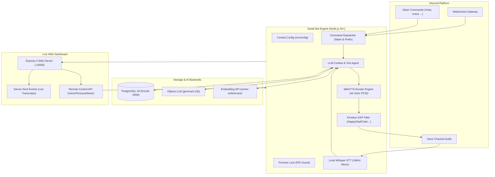

# 🌸 Seola Bot (설아 디스코드 봇)

> **로컬 엣지 AI 기반 고음질 한국어 음성 비서 & 자율 페르소나 디스코드 봇**  
> 44.1kHz MeloTTS 감정 합성 · 로컬 Whisper STT · Ollama LLM · 개인화 벡터 RAG 기억 · 실시간 원격 제어 대시보드 · 디스코드 슬래시(/) 명령어 완벽 지원

---

## 🏛️ 시스템 아키텍처 (System Architecture)



---

## ✨ 핵심 기능 요약

### 1. 🎙️ 초저지연 실시간 음성 통화 (Voice Call Mode)
- **로컬 Whisper STT**: `@huggingface/transformers`를 통해 GPU/NPU 가속 로컬 신경망으로 한국어 음성을 실시간 텍스트 변환합니다.
- **짧고 자연스러운 음성 대화**: 1:1 통화 시에는 호출어 없이 자연스럽게 대화하며, 음성 통화 모드에서는 발화를 요약해 대답합니다(최대 2문장, 40자 내외).
- **Time-to-First-Audio (TTFA) 최적화**: 문장 단위 조기 스트리밍 플러시 및 420ms 무음 감지(VAD)로 응답 지연 시간을 최소화했습니다.

### 2. 🗣️ MeloTTS-Korean 44.1kHz 감정 합성 엔진
- **44.1kHz FP32 ONNX 로컬 음성 합성**: 클라우드 API 의존 없이 로컬에서 고음질 한국어 음성을 즉각 합성합니다.
- **실시간 감정 DSP 필터**: LLM 대화의 어조를 감지하여 억양, 피치, 리버브, 템포를 실시간 조절합니다 (`기쁨/신남`, `슬픔/위로`, `화남`, `차분함`, `속삭임`, `장난스러움`).
- **다양한 목소리 프리셋**: `seola`(설아, 기본), `lively`(발랄), `calm`(차분), `whisper`(속삭임), `melo`(멜로), `ava`(아바), `sunhi`(선희).

### 3. 🎭 동적 페르소나 시스템 (Persona Engine)
- 유저별로 독립된 시스템 프롬프트를 PostgreSQL에 저장 및 즉시 전환합니다.
- **기본 페르소나**:
  - `girlfriend` (다정한 여자친구, 기본값)
  - `assistant` (스마트한 AI 비서)
  - `tsundere` (츤데레 소꿉친구)
  - `senior` (든든하고 자상한 선배)
  - `cute` (애교 많고 발랄한 여동생)
  - `custom` (유저가 직접 지정한 자유 커스텀 시스템 프롬프트)

### 4. 🧠 벡터 검색(Vector RAG) 기반 개인화 장기 기억
- 유저와의 대화 중 중요한 선호도, 취향, 개인 정보, 약속을 자동 추출(Implicit Memory Extraction)하여 벡터화합니다.
- 로컬 `nomic-embed-text` 임베딩 및 코사인 유사도 검색을 통해 관련성 높은 기억을 문맥에 주입하여 대화합니다.

### 5. 🎛️ 실시간 음성 대화록 & 원격 제어 웹 대시보드
- **실시간 대화록 스트리밍 (SSE)**: 음성 통화 내용은 채팅 채널에 올라가지 않고 전용 웹 대시보드(`http://localhost:13000/dashboard`)에서 실시간으로 스트리밍됩니다.
- **실시간 원격 제어 패널**: 웹 UI에서 디스코드 봇의 페르소나, 목소리 프리셋, 음성 세션 일시중지/재개/퇴장, 음악 재생/정지를 실시간 조작할 수 있습니다.
- **대화록 및 기억 관리**: 유저별 대화 검색, 단일 항목 삭제, 대화록 전체 비우기, 기억 관리 기능을 제공합니다.

### 6. 🛡️ 단일 인스턴스 락 & Graceful Teardown
- `src/util/processLock.ts`를 통해 중복 프로세스 실행을 원천 차단하고 기존 프로세스를 안전하게 인계받습니다.
- 프로세스 종료 시(`SIGINT`, `SIGTERM`) 접속 중인 모든 음성 채널에서 자동 퇴장하고 리소스를 안전하게 정리합니다.

---

## ⚡ 디스코드 명령어 가이드

### 슬래시(/) 명령어 (권장)

| 슬래시 명령어 | 옵션 | 설명 |
| :--- | :--- | :--- |
| `/chat` | `message` (필수) | 설아와 AI 대화 (개인별 페르소나 및 장기 기억 반영) |
| `/persona` | `type` (선택), `custom_prompt` (선택) | 현재 페르소나 조회 또는 변경 (`girlfriend`, `assistant` 등) |
| `/voice` | `action` (입장/퇴장/듣기중지/듣기재개) | 음성 채널 접속 및 실시간 음성 통화 제어 |
| `/preset` | `voice` (선택) | 설아의 TTS 목소리 프리셋 조회 또는 변경 |
| `/memory` | `action` (목록/추가/삭제), `text` 등 | 개인화 장기 기억(RAG) 확인 및 수동 추가/삭제 |
| `/music` | `song` (필수) | 음성 채널에서 지정한 음원 스트리밍 재생 |
| `/search` | `query` (필수) | 실시간 웹·뉴스·위키백과 검색 및 AI 요약 |
| `/model` | `name` (선택) | 현재 유저의 LLM 모델 조회 또는 변경 |
| `/improve` | `instruction` (필수), `engine` | Antigravity CLI(`agy`) / Hermes 에이전트로 봇 코드 자기개선 |
| `/status` | - | 프로세스 PID, 업타임, 메모리, 음성 세션, 대시보드 상태 조회 |
| `/help` | - | 전체 기능 및 명령어 인터랙티브 도움말 확인 |

### 프리픽스(!) 및 호출어 대화

| 프리픽스 / 호출어 | 설명 |
| :--- | :--- |
| `설아야 <할 말>` / `설아 <할 말>` | 텍스트 대화 (개인별 문맥 및 페르소나 유지) |
| `설아야 이리온` / `설아야 들어와` | 사용자가 접속한 음성 채널에 입장하고 통화 시작 |
| `설아야 꺼져` | 음성 채널에서 퇴장 (음성으로 말해도 퇴장) |
| `설아야 <곡명> 틀어줘` | 지정한 곡 재생 (음성으로 말해도 재생) |
| `!persona [이름]` / `!페르소나` | 페르소나 목록 확인 및 변경 (`!persona custom <프롬프트>`) |
| `!voice [프리셋]` / `!목소리` | 목소리 프리셋 목록 확인 및 변경 |
| `!dashboard` / `!대시보드` | 실시간 웹 대시보드 주소 확인 |
| `!models` / `!model <이름>` | Ollama 모델 목록 확인 및 유저별 모델 변경 |
| `!search <검색어>` / `!검색` | 실시간 웹 검색 실행 |
| `!improve <요청>` / `!자기개선` | 코드 자기개선 작업 실행 |
| `!restart` / `!재시작` | 봇 프로세스 안전 재시작 |
| `!status` / `!상태` | 봇 프로세스 및 메모리 상태 리포트 |

---

## ⚠️ Discord Developer Portal 설정 필수 점검사항

> [!IMPORTANT]
> 디스코드에서 슬래시 명령어 사용 시 `The application did not respond` 오류가 발생하는 경우, **Discord Developer Portal 외부 설정**을 반드시 확인하세요:
> 
> 1. **Interactions Endpoint URL은 반드시 비워두어야 합니다**:
>    - 포털의 `General Information` → `Interactions Endpoint URL`에 ngrok이나 웹훅 URL이 등록되어 있으면, 디스코드가 WebSocket Gateway 대신 HTTP 웹훅으로 인터랙션을 전송하여 봇이 명령어를 수신하지 못합니다.
> 2. **Privileged Gateway Intents 활성화**:
>    - `Bot` 탭에서 `Message Content Intent`, `Server Members Intent`가 활성화되어 있어야 합니다.

---

## 🚀 빠른 시작 (Getting Started)

### 1. 사전 요구사항
- **Node.js**: `>= 24.0.0` (네이티브 TypeScript 지원)
- **Docker & Docker Compose**: PostgreSQL 18 구동
- **Ollama**: 로컬 LLM 서버 (`http://localhost:11434`)
  ```bash
  ollama pull gemma4:12b
  ollama pull nomic-embed-text
  ```

### 2. 환경 변수 설정
```bash
cp .env.example .env
```
`.env` 파일에 발급받은 Discord 봇 토큰과 설정을 입력합니다.

### 3. 데이터베이스 구동
```bash
docker compose up -d
```

### 4. 패키지 설치 및 실행

```bash
# 의존성 설치
npm install

# TypeScript 타입 검증
npm run build

# 개발 모드 (파일 변경 자동 감지)
npm run dev

# PM2 백그라운드 무중단 실행 (프로덕션 권장)
npm run pm2:start
npm run pm2:logs
```

---

## 📁 프로젝트 구조

```text
discord-bot-seola/
├── compose.yaml              # PostgreSQL 18 컨테이너 구성
├── ecosystem.config.cjs      # PM2 무중단 프로덕션 프로세스 설정
├── package.json
├── src/
│   ├── index.ts              # 메인 엔트리포인트 (초기화, 이벤트 바인딩, Graceful Shutdown)
│   ├── config/
│   │   └── index.ts          # 중앙 집중형 환경 설정 관리자 (단일 진실 공급원)
│   ├── db/
│   │   ├── index.ts          # 통합 데이터베이스 풀 인스턴스 (Drizzle ORM)
│   │   └── schema.ts         # 테이블 정의 (contexts, user_models, user_personas, user_memories, voice_logs)
│   ├── dashboard/
│   │   └── index.html        # 독립형 실시간 음성 대화록 & 원격 제어 웹 대시보드
│   ├── audio/                # 로컬 스트리밍 음원 디렉터리 (.gitignore)
│   └── util/
│       ├── slashCommands.ts  # 11종 디스코드 슬래시(/) 명령어 등록 및 실행기
│       ├── prefixCommands.ts # 프리픽스(! 및 "설아야") 메시지 디스패처
│       ├── voiceChat.ts      # 실시간 음성 파이프라인 (Whisper STT + VAD + 발화 제어)
│       ├── meloTts.ts        # 44.1kHz MeloTTS 로컬 엔진 & 실시간 감정 DSP 필터
│       ├── persona.ts        # 6종 페르소나 정의 및 유저별 동적 전환기
│       ├── memoryRag.ts      # 벡터 RAG 장기 기억 저장·검색·추출 엔진
│       ├── dashboard.ts      # Express 대시보드 라우트, SSE 스트림 및 원격 제어 REST API
│       ├── processLock.ts    # 단일 인스턴스 PID 파일 락 관리자
│       ├── tools.ts          # 에이전트 도구 (웹 검색, 재시작, agy/hermes 자기개선)
│       ├── helper.ts         # Ollama LLM 대화 생성 및 문맥 관리
│       └── songmap.ts        # 음악 키워드 ↔ MP3 매핑
```
